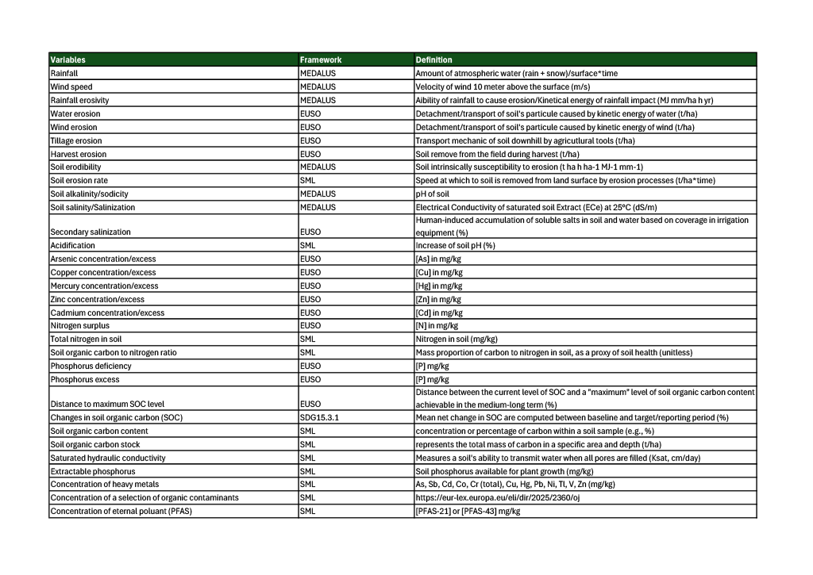
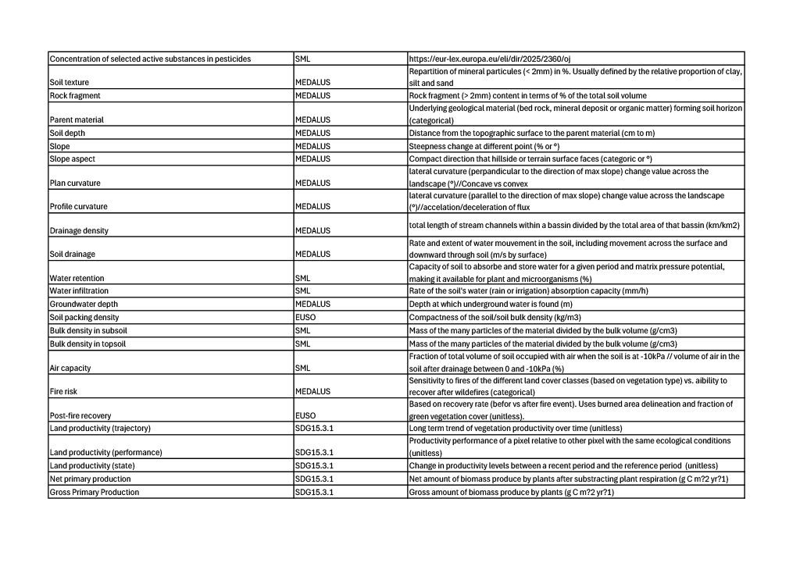
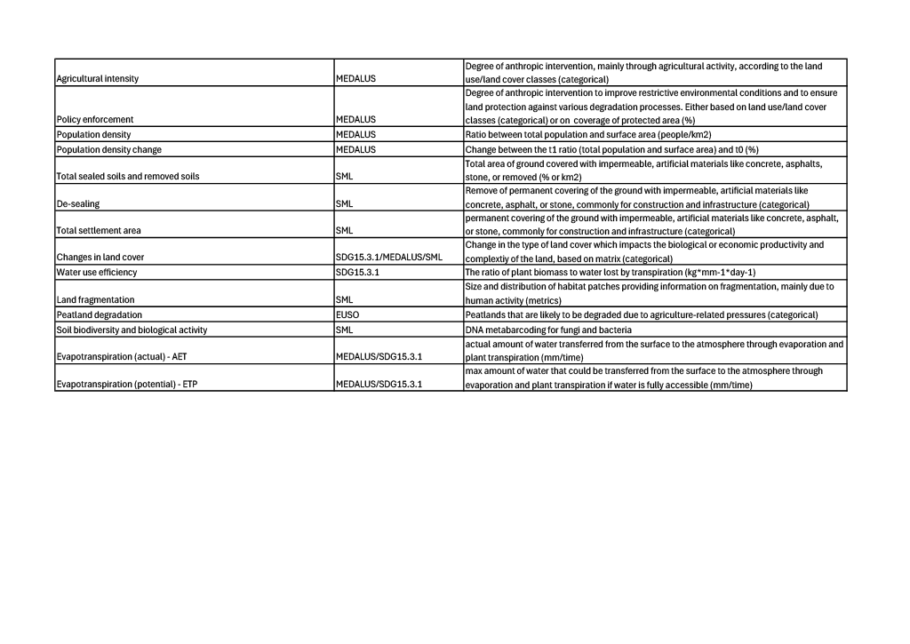

# Defining Essential Land Variables (ELV) for Land Degradation and Desertification monitoring and assessment 

## Overview
Land degradation and desertification (LDD) monitoring and assessment remains highly fragmented. A wide range of indicators and datasets are used across scientific, policy, and operational communities, often relying on similar underlying data but remaining poorly connected. This lack of coordination limits the comparability, scalability, and overall effectiveness of assessments at regional and global scales.

To address similar challenges, other domains (climate, oceans, biodiversity) have adopted the concept of **Essential Variables (EVs)**, a minimal set of policy-relevant variables that consistently describe system state and dynamics.

## Objective
This project contributes to the development of **ELV**. It builds on established frameworks such as:
- MEDALUS / ESAI methodology  
- SDG 15.3.1 indicator framework  
- EU Soil Monitoring Law  
- EU Soil Observatory  

The goal is to support a more coherent, coordinated, and scalable approach to LDD monitoring and assessment.

## Scope
This repository supports:
- the refinement of candidate **ELV**  
- the evaluation of selection criteria  
- the identification of relevant data sources  

## Process
This work is part of an iterative effort involving expert feedback.

> A first questionnaire aims to help validate the proposed criteria and classification, while also incorporating expert feedback. It represents an initial step in a broader, iterative process aimed at refining, consolidating, and ultimately operationalizing a robust set of candidate **ELV**.
> A Second questionnaire focuses on structuring the identified variables into sets and refining their selection. It also aims to define a maturity index for each variable.
>

